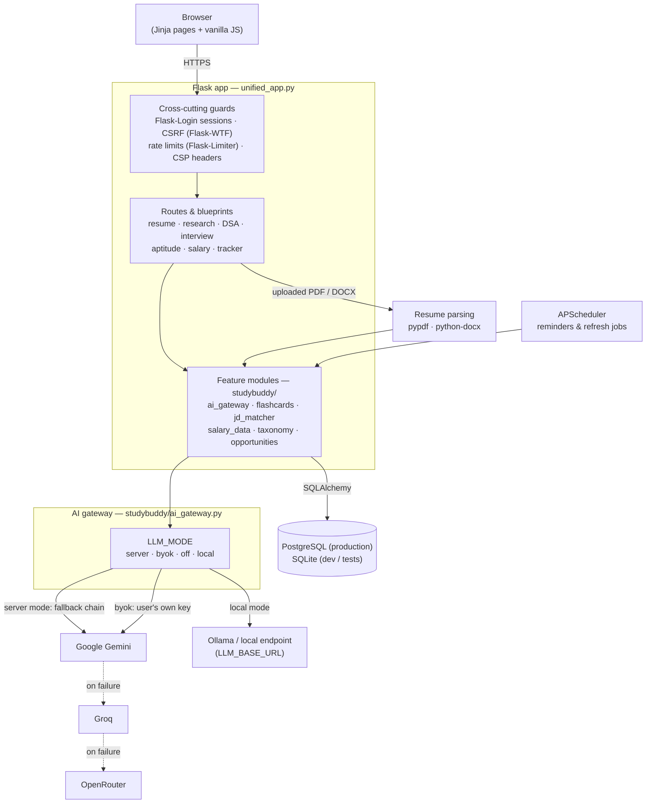

# Architecture

Study Buddy is a single Flask application (`unified_app.py`) backed by
feature modules in the `studybuddy/` package, server-rendered Jinja
templates, and one relational database. There is no separate frontend
build and no microservices — a deliberate choice for a small team:
one process to deploy, one codebase to test.

## Request flow

1. The browser loads a server-rendered page. Every response carries a
   Content-Security-Policy header with a per-request nonce; violations
   are posted to `/csp-report` and logged.
2. Form posts are CSRF-protected (Flask-WTF). Login state lives in a
   server-side session via Flask-Login; passwords are hashed and
   login attempts are rate-limited.
3. Feature routes delegate to `studybuddy/` modules — the route layer
   stays thin, and the modules are unit-testable without HTTP.

## AI calls

All model traffic goes through one gateway (`ai_gateway.py`), so the
privacy modes in [No-LLM / BYOK / Local](selfhost/privacy-modes.md)
apply everywhere at once:

- **server** — the deployment's keys, tried in order
  Gemini → Groq → OpenRouter.
- **byok** — the signed-in user's own provider key, stored
  Fernet-encrypted and only ever decrypted in memory.
- **off** — no AI calls; rule-based fallbacks answer instead, with a
  visible "degraded" notice.
- **local** — an OpenAI-compatible endpoint from `LLM_BASE_URL`
  (e.g. Ollama on the same machine).

Resume text is only sent to a provider after the user records LLM
consent (see the privacy reference); the consent record travels with
the account export.

## Data

- One SQLAlchemy database: PostgreSQL on Render, SQLite for local
  development and most of the test suite (CI runs both).
- Static datasets (questions, salary ranges, skills taxonomy,
  opportunities) live as JSON under `data/` with provenance fields
  checked by `scripts/validate_data.py`.
- Uploaded resumes are parsed in memory (pypdf / python-docx) and are
  not stored as files.

## Background work

APScheduler jobs inside the same process send study reminders and
refresh time-sensitive data. There is no task queue — at this scale
an external worker would be pure overhead.
